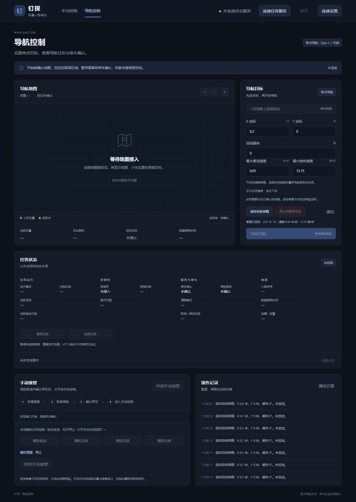
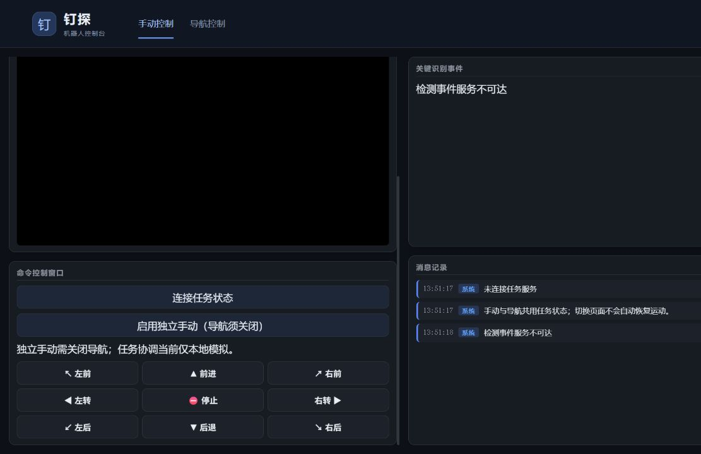

# Web 优化与启动说明（2026-10-02）

保留两页原有分栏、视频大小和布局。新增连接设置与必要状态/接管控件；未重排页面。本轮仅电脑端开发和模拟验收，没有连接小车、部署代码、启动硬件或发送真实移动命令。

## 已完成

- 两页共用连接设置：热点、Type-C、自定义服务地址；保留旧导航地址并迁移。保存和切页均不自动发送目标。
- 手动页订阅同一任务 v1 状态，支持本地模拟申请/结束接管。导航页与手动页仍各有独立控制会话，切页撤销旧控制；新页重新读取状态并申请，不能两个页面同时控制。
- 手动方向默认禁用。独立模式需主动启用，并要求导航关闭；已知导航/任务正在运行时禁用独立控制。协调模式仅向声明本地模拟能力的回环服务开放，真实接口仍只读。
- 按住、松开、触摸取消、失焦和隐藏均撤销输入；状态过期禁用控制。结束模拟接管后保持 PAUSED，显式恢复才继续目标。
- 视频支持 YOLO/原始画面选择、手动重连、断流退避重试。能读取 MJPEG 时显示实际接收帧的电脑时间，5 秒没有完整帧则重连。接收时间不代表 ROS 相机源时间。
- 缺少 CORS 的旧视频服务回退至原有图片方式，并标注“帧时间未提供 / 实时性未确认”。此方式无法可靠识别画面冻结，不虚构帧时间。
- 事件请求串行、超时和切址隔离；有源时间时检查新鲜度，有事件编号时去重；旧接口没有这些字段时明确提示，并沿用数量变化的兼容行为。
- 日志按纯文本显示；事件超过 50 条删除最旧记录。

## 电脑启动

双击根目录 `start_web.cmd`。它切换到项目目录，启动仅监听电脑回环地址的服务并打开网页，默认端口 8000。

也可继续使用原来的 `python -m http.server 8000`。不要同时运行两个占用 8000 的服务。

终端方式：

```powershell
python tools/serve_web.py --open
# 原端口占用时
python tools/serve_web.py --port 8002 --open
```

普通模式只启动电脑网页。小车端相机、YOLO、视频、控制服务仍需另行启动。进入连接设置，选择热点或 Type-C，按需填写任务服务地址。连接任务状态不启动导航。

默认沿用 `http://localhost:8000`。浏览器配置按网址保存，`localhost` 与 `127.0.0.1`、不同端口的存储各自独立；两页通过相对链接切换即可共用当前网址的配置。

## 充电期间本地模拟

双击 `start_simulation.cmd`。默认从旁边的 `小车/tools/local_navigation_control.py` 复用既有模拟器；只导入无 ROS、无 SSH 的任务和控制逻辑。

模拟网址包含 `?simulation=1`。两页所有服务地址均指向当前电脑，实车连接设置保持原值；模拟预览的设置只读。切页保留模拟参数，所有移动、定位、停车和清理均模拟，没有相机视频。

```powershell
python tools/serve_web.py --simulate --open
```

关闭窗口前按 Ctrl+C，停止电脑服务和模拟器。该命令不管理小车端服务。

## 小车端统一启动脚本：准备完成，尚待实车验收

`tools/robot_web_stack.py` 需复制到小车后运行；本轮没有复制或运行。

```powershell
scp tools/robot_web_stack.py wheeltec@192.168.55.1:/home/wheeltec/robot_web_stack.py
```

在小车终端：

```bash
python3 /home/wheeltec/robot_web_stack.py
```

按顺序启动相机，等待至少 3 帧新鲜图像，再在独立进程激活 wheeltec conda 环境启动 YOLO，等待检测画面，再启动原有视频/控制服务并检查端口。相机时间异常会拒绝通过准备检查。

启动前拒绝已有相机、YOLO、Web、导航或雷达进程，避免重复启动。脚本不启动底盘、Nav2 或雷达，不发送速度请求；因此不替代底盘的原有启动流程。独立手动仍需确认导航关闭及现场条件。

按 Ctrl+C 或收到 SIGTERM 后，先 SIGINT、再按需升级信号，仅终止本次拥有的进程组；保留报告和日志并检查相关进程及雷达残留。不能退出干净时明确报告失败，不宣称已省电。其他工具启动的雷达仍需由其对应测试入口关闭和核验。

该脚本暂不启动检测事件桥：上次小车安装包中没有 `web_event_bridge`。5001 的真实检测反馈部署需充电后核验；网页现会准确显示接口不可达。

## 验证和实车边界

运行 `node --test tests/*.test.mjs` 检查接口、控制撤销、过期状态和视频解析。22 项通过。`tests/browser-smoke.cjs` 使用 Playwright、Edge 和电脑模拟器，检查两页导航/接管流程及视频断流恢复，拦截所有实车地址；`tests/launcher-smoke.cjs` 验证 8000 端口的同源模拟服务、共用配置与切页，二者均通过。

新手动页不会把 HTTP 成功写成实际停车；真实控制协调仍需接入 ROS 取消回执、里程计和统一速度仲裁。旧 `/cmd` 接口没有服务端租约、方向序号或命令有效期，这些不能靠网页补齐。原来由机器人提供的只读静态页面资源白名单也需随新文件更新后重新部署；当前请从电脑端网页服务使用新版。

后续实车测试完成后关闭雷达及本轮服务、核验退出，再进行分析。每项优化均独立 Git 提交。


## 导航布局与地图视图同步（2026-10-06）

- 桌面导航地图与导航目标等高；任务状态移到下方，四个状态分组横向填满宽度。中等屏幕两组一行，手机逐组排列。
- 停止任务按钮移到保存目标草稿旁，保留唯一按钮和原控制逻辑，明确设为普通按钮，避免触发表单保存。
- 操作记录与手动接管等高，消息使用全部可用宽度，超出高度后在记录区域滚动；新消息置顶，并自动滚动到顶部。保留最近 50 条。
- 同一地图更新数据时保留缩放与拖动视图；地图标识、尺寸、分辨率或原点变化时重新适配。为本次 CSS、入口脚本和地图模块添加版本地址，刷新加载新文件。
- 验证：34 项 Node 测试通过。使用本地测试地图每 500 毫秒刷新，拖动、放大后连续点击相同位置得到相同坐标，拖动不会误选目标。实际页面离线保存 16 次草稿形成内部滚动，从记录底部保存新草稿后 scrollTop 回到 0，最新 X=0.2 的消息排首位。桌面两张顶部卡片均约 586 px，任务状态与工作区同宽；记录与接管均约 397 px。390 px 手机视口无横向溢出。未发送实车指令。




## 手动按钮旧样式缓存修复（2026-10-06）

手动页按钮的深色圆角规则仍保存在 26c6005，后续提交未修改 index.html / styles.css。8000 服务返回的两份文件与工作区一致，但浏览器仍使用旧样式：连接任务状态、启用独立手动、重连按钮计算背景为 rgb(240, 240, 240)，圆角为 0。为 index.html 中 styles.css 的引用增加版本地址后，原样式恢复为 rgb(27, 39, 56)、8px 圆角。只修改资源加载地址，按钮布局、文字和控制逻辑不变。浏览器刷新、计算样式和截图核验完成，没有发送控制请求。


